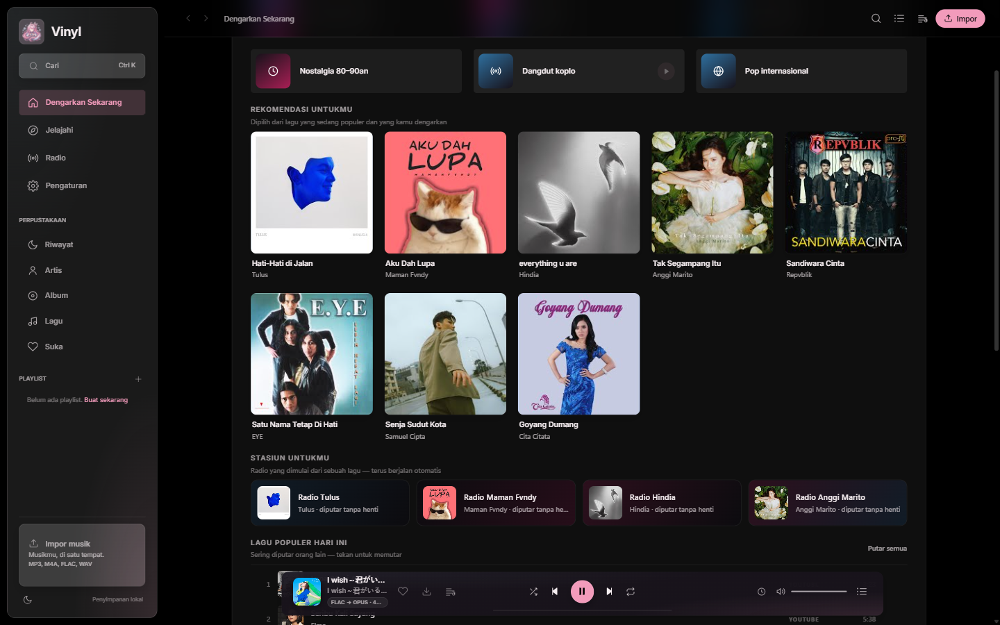

<div align="center">
  

  <h1>Vinyl</h1>

  <sub>Pemutar musik streaming semi-Apple Music yang tinggal buka, cari, putar. Tanpa akun, tanpa iklan, tanpa drama. Ada versi web, Windows, dan macOS — dan tentu, open source >_<</sub>

  <br /><br />

  <a href="https://github.com/ZakiMisuchaAndefi/Vinyl/releases/latest"></a>
  <a href="https://github.com/ZakiMisuchaAndefi/Vinyl/releases"></a>
  
  <a href="https://github.com/ZakiMisuchaAndefi/Vinyl/stargazers"></a>
  <a href="LICENSE"></a>
</div>

> [!WARNING]
> Streaming dan FLAC butuh internet. Kalau sumbernya sedang ngambek, coba lagi beberapa saat ya.

---

## Mau dengerin? (●'◡'●)

1. **Paling gampang** — buka **[vinyl.my.id](https://vinyl.my.id)**, cari lagu, putar. Nggak perlu install apa pun.
2. **Mau aplikasi desktop?** Ambil di [releases terbaru](https://github.com/ZakiMisuchaAndefi/Vinyl/releases/latest):
   - Windows → `Vinyl-Setup-x.y.z.exe`
   - macOS → `Vinyl-x.y.z-universal.dmg` (Intel + Apple Silicon)
3. **Update?** Buka **Pengaturan → Tentang → Cek pembaruan**, lalu **Unduh** dan **Pasang & mulai ulang**. Nggak perlu buka browser lagi.

> [!NOTE]
> Build macOS belum ditandatangani Apple. Kalau macOS bilang aplikasinya rusak, jalankan ini sekali: `xattr -dr com.apple.quarantine /Applications/Vinyl.app`



## Yang bisa kamu lakuin

- **Streaming tanpa ribet** — cari lagu atau tempel tautan YouTube, audio murni tanpa iklan dan tanpa tampilan video.
- **FLAC lossless** — kalau lagunya tersedia di katalog, dengerin versi lossless; kalau nggak, otomatis balik ke audio terbaik.
- **Lirik sinkron + romanisasi** — baris aktif membesar, aksara non-Latin dapat transliterasi lokal.
- **Unduh lagu** — FLAC atau audio YouTube langsung dari browser, tanpa `ffmpeg`.
- **Perpustakaan sendiri** — impor MP3, FLAC, M4A, WAV, atau OGG; metadata dan sampul dibaca otomatis dan disimpan lokal.
- **Radio otomatis** — antrean lanjut sendiri kayak autoplay, tapi nggak ngasal.
- **Pemutar lengkap** — tema gelap AMOLED/terang, panel lirik, timer tidur, antrean, acak, ulangi, dan pintasan keyboard.
- **Desktop offline-friendly** — perpustakaan, pengaturan, dan tampilan tetap jalan tanpa internet; streaming saja yang butuh koneksi.

## Jalanin sendiri

**Web** — buka [vinyl.my.id](https://vinyl.my.id), atau deploy repo ini ke Vercel. `api/*.js` otomatis jadi serverless function dan Web Analytics tinggal diaktifkan dari dashboard.

**Lokal** — butuh Node.js dan PowerShell:

```powershell
powershell -NoProfile -ExecutionPolicy Bypass -File .\server.ps1
# lalu buka http://127.0.0.1:4173/
```

**Desktop**:

```powershell
npm install
npm start          # coba tanpa installer
npm run dist       # Windows installer -> dist\Vinyl-Setup-<versi>.exe
npm run dist:mac   # macOS DMG + ZIP universal (harus di macOS)
```

**Rilis versi baru**:

1. Naikkan `version` di `package.json`.
2. `git tag vX.Y.Z && git push origin vX.Y.Z`
3. Workflow `.github/workflows/release.yml` bikin draf → build Windows + macOS → unggah → terbitkan.

## FAQ

**Perlu akun?** Nggak. Cari, putar, lirik, dan unduh semuanya tanpa login.

**Dataku dikirim ke mana?** Perpustakaan, riwayat, dan pengaturan cuma tersimpan di perangkatmu. Yang keluar cuma kata kunci pencarian dan permintaan audio ke penyedia.

**macOS bilang aplikasinya rusak?** Karena belum dinotarisasi. Jalankan `xattr -dr com.apple.quarantine /Applications/Vinyl.app` sekali saja.

**Update otomatis di macOS?** Untuk sekarang unduh DMG baru secara manual. Auto-update penuh butuh sertifikat Developer ID.

**Kenapa nggak ada Spotify?** Pemutaran Spotify butuh Premium, OAuth, dan Web Playback SDK — arsitekturnya beda. Vinyl pakai `<audio>` biasa.

**Boleh fork atau ubah?** Boleh banget! Proyek ini berlisensi **GPL-3.0-or-later** (lihat [LICENSE](LICENSE)) — jadi kalau kamu memodifikasi atau mendistribusikan ulang, turunannya juga harus tetap open source di bawah GPL-3.0 (atau lebih baru), plus sertakan pemberitahuan hak cipta dan kredit pihak ketiga di [THIRD_PARTY_NOTICES.md](THIRD_PARTY_NOTICES.md) ya.

## Mau bantu?

Punya ide, nemu bug, atau mau kirim PR? Mampir ke [CONTRIBUTING.md](CONTRIBUTING.md) buat panduan singkatnya ya (●'◡'●)

## Terima kasih ☆*: .｡. o(≧▽≦)o .｡.:*☆

Vinyl berdiri di atas kerja orang-orang keren ini. Mampir dan kasih star kalau sempat!

| Proyek | Lisensi | Dipakai untuk |
| --- | --- | --- |
| [Electron](https://github.com/electron/electron) | MIT | Runtime aplikasi desktop Windows & macOS |
| [electron-builder](https://github.com/electron-userland/electron-builder) | MIT | Installer NSIS, DMG, dan ZIP universal |
| [electron-updater](https://github.com/electron-userland/electron-builder/tree/master/packages/electron-updater) | MIT | Pembaruan dari GitHub Releases |
| [Inter](https://github.com/rsms/inter) | SIL OFL 1.1 | Font antarmuka |
| [pinyin-pro](https://github.com/zh-lx/pinyin-pro) | MIT | Romanisasi lirik Mandarin |
| [LRCLIB](https://github.com/tranxuanthang/lrclib) | MIT | Lirik sinkron lewat `lrclib.net` |
| [Monochrome](https://github.com/monochrome-music/monochrome) | Apache-2.0 | Katalog dan streaming FLAC Tracks |
| [Invidious](https://github.com/iv-org/invidious) | AGPL-3.0 | Audio YouTube di versi web |
| [tombulled/innertube](https://github.com/tombulled/innertube) | MIT | Referensi klien InnerTube |
| [@vercel/analytics](https://github.com/vercel/analytics) | MIT | Analitik halaman yang ramah privasi |

Juga terima kasih untuk **YouTube / YouTube Music**, **Tracks** (`tracks.monochrome.st`), **LRCLIB**, **Vercel**, **GitHub Actions & Releases**, serta para operator instance **Invidious** publik yang menjaga server dan bandwidth tetap hidup. Tanpa mereka, Vinyl cuma jadi pemutar file kosong.

Dan buat kamu yang melaporkan bug, memberi masukan, atau sekadar mampir dengerin — thank you, seriously.

## Lisensi

Vinyl dilisensikan di bawah **GNU General Public License v3.0 or later (`GPL-3.0-or-later`)** — lihat berkas [LICENSE](LICENSE) untuk teks lengkapnya. Untuk komponen pihak ketiga yang dibundel atau dirujuk, cek [THIRD_PARTY_NOTICES.md](THIRD_PARTY_NOTICES.md) ya :3

## Disclaimer

Vinyl adalah proyek pribadi yang dibagikan apa adanya. Tidak berafiliasi dengan YouTube, Apple Music, Monochrome, Invidious, LRCLIB, atau Vercel. Vinyl tidak menyimpan atau meng-host musik; semua audio diambil dari penyedia saat kamu minta. Nama dan merek dagang milik pemiliknya masing-masing.

Dibuat sambil dengerin yoasobi full nonstop pake IEM dan format FLAC!! [Zaki Misucha Andefi](https://github.com/ZakiMisuchaAndefi).
